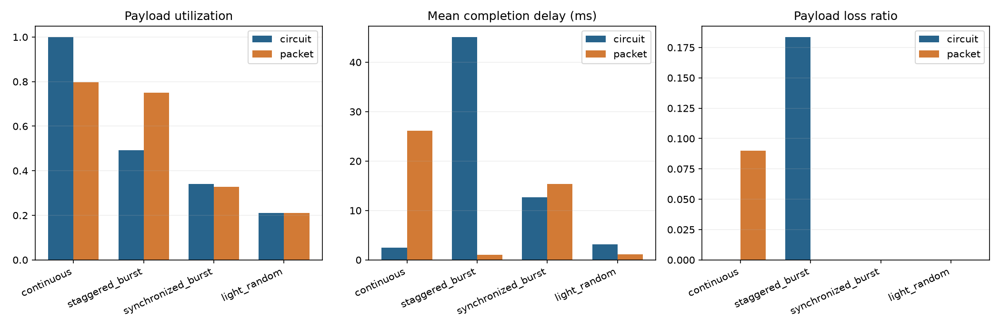

# 实验一报告

姓名：谢紫佳  学号：2024280105  GitHub：ziakj  提交编号：填写

## 实验目的
对比固定时隙电路交换、共享FIFO分组交换两种交换机制，理解二者在资源分配方式上的核心差异；通过仿真观测有效载荷利用率、端到端时延、丢包率、队列积压等指标，分析不同流量负载下两种交换方式的性能优劣，掌握有限观察窗口下网络指标统计方法。

## 原理和模型
本实验模型包含固定时隙电路交换与共享FIFO分组交换两种发送逻辑。
- **固定时隙电路交换**：时隙按用户编号静态分配，`tick % cfg.users` 确定当前tick服务的用户，时隙不可借用。用户在分配到的时隙内在slot_bits预算内发送，支持分片发送一条记录，数据包必须完整发送完成才判定为交付。
- **共享FIFO分组交换**：所有流量进入同一个共享FIFO队列，链路带宽由全部分组共享；分组允许跨tick续传、不允许分组交错发送，队首分组发送完毕才处理下一个分组。

模型包含包头开销、payload载荷、FIFO缓存、有限观察窗口统计规则；PCM帧示例是电路交换时隙分配的具象化例子，抽象链路模型忽略物理层细节，只关注比特预算与时隙调度逻辑。

## 手工推演
采用2用户固定时隙电路交换场景：cfg.users=2，slot_bits=128 bit，header_bits=32 bit。
待发送报文：payload=96 bit，加上包头后总长度 96+32=128 bit，刚好等于一个时隙的比特预算，放在user1的队列；user0队列为空。
时隙分配规则：当前服务用户 = tick % cfg.users
1. tick = 0：tick%2 = 0，时隙分配给 user0。虽然 user1 队列有报文等待发送，但电路交换时隙不允许借用。
   预期：发送比特=0，报文留在user1队列内，remaining_wire_bits保持128不变，无报文完成交付。
2. tick = 1：tick%2 = 1，时隙分配给 user1。该报文总比特128刚好等于时隙预算，可以一次性完整发送。
   预期：发送比特=128，报文发送完毕，移入completed完成列表，user1队列清空。

这个推演和自拟反例`test_circuit_no_borrow_timeslot`输入完全一致，用来核对serve_circuit是否遵守时隙独占、不能跨用户借时隙的规则。

## 实验结果

对比两种交换在低负载、中等负载、高负载下的四项指标：有效载荷利用率、平均时延、丢包率、队列积压。
- 低负载时：分组交换共享链路，链路利用率更高；电路交换时隙固定，空闲时隙直接浪费，利用率偏低。
- 高负载时：电路交换带宽隔离，时延稳定、抖动小；分组交换容易产生队列排队，平均时延显著上升，队列积压持续增加。
例子：**高负载场景下，分组交换利用率更高，但是时延远大于电路交换**，体现利用率和时延两个指标指向不同结论。

## 自拟反例
说明student_tests/test_my_case.py的输入、手算预期、断言和它能揭示的实现错误。

输入：users=2，slot_bits=128；user0队列为空，user1有一条总长度128bit报文（payload96+包头32）。tick=0服务user0，tick=1服务user1。
手算预期：tick=0不能借用时隙，发送0bit，报文保留；tick=1轮到user1，完整发送128bit。
断言：tick0时wire_bits==0、队首报文不变；tick1时wire_bits2==128、报文完成。
作用：检验电路交换时隙不可跨用户借用，捕获不判断tick归属就发送的错误。。

## 分析与限制
1. 分组交换在流量稀疏、突发流量场景更有优势，可以利用空闲链路资源；电路交换适合恒定速率、对时延抖动要求严格的业务。
2. 满载连续长分组场景下分组交换未必更好：长包持续占用链路，后面的分组全部排队，排队时延急剧增加，容易造成拥塞。
3. 未完成数据不能当成丢包：本实验里未完成只是暂时积压在队列，后续tick还有机会继续发送；丢包是明确被丢弃的流量，二者定义不能混淆。
4. 不能只看成功记录的平均时延：只统计成功交付的记录会忽略还在排队的积压分组，低估系统整体排队压力，需要同时观测队列积压指标。

## AI使用说明
关联AI_LOG.md，AI辅助完成了serve_circuit、serve_packet、summarize三个函数的逻辑框架、边界分支处理，同时辅助编写自拟测试用例；核心循环（FIFO出队、剩余比特扣减、时隙用户判定）、断言验证逻辑由本人核对、调试、pytest验证通过。

## 参考资料
1. 课堂课件：电路交换与分组交换原理对比
2. 实验文档README、模型接口注释文档
3. Computer Networking: A Top-Down Approach（计算机网络自顶向下）
